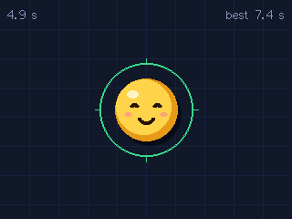
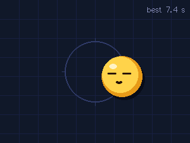
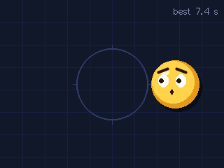
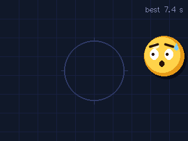
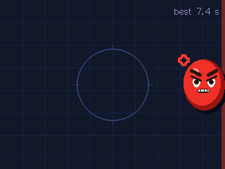
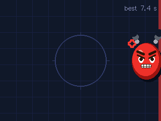
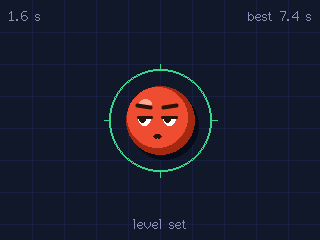

# Balance Ball

A ball with a face that only wants one thing: to sit in the middle of the screen. Tilt the board and it rolls
the way you tilt it. Your job is to keep it home. The closer it gets to a wall, the more worried it looks, and the
moment it touches one it turns red and angry. Hold it there and it fumes. No sound, just faces.

| | | | |
|---|---|---|---|
|  happy |  blissful |  content |  worried |
|  panicking |  angry |  fuming |  sulking |

Screenshots taken from the device with `host/ball.py gallery docs`, which holds the ball at a spot for each mood
and checks the frame really shows it. On the board it rolls, blinks, trembles and steams.

## How to play

- **Hold it however you like and tap the screen.** That pose becomes level, and the ball goes back to the middle.
  At power-up it takes the pose it is in after 0.7 s.
- **Tilt it** and the ball rolls downhill. Held flat, it behaves like a marble on a tray. Held upright, lean it left
  or right to roll it sideways, and tip the top away from you or towards you to roll it up or down.
- **Keep it in the ring.** The middle sits on top of a gentle hill, so even a perfectly level board lets it drift
  off; you have to keep nudging it back. The ring turns green while it is home, the top left counts how long it
  has stayed, and the top right keeps your best.

| Where it is | It feels |
|---|---|
| In the ring | happy, smiling at you; blissful after 3 s, eyes closed |
| A little off the middle | content, glancing back at the middle |
| A wall within 45 px | worried, brows up |
| A wall within 15 px | panicking, wide eyes, sweating |
| Touching a wall | angry: turns red, squashes flat against it, the wall flashes |
| Against a wall for 1.5 s | fuming: steam, teeth bared, shaking |
| Just rescued | still angry for 1.2 s, then sulks, looking away, while the red fades over 3 s |

## How it works

- **Tilt** (`lib/ball/src/level`): the IMU is read 100 times a second on core 0 and smoothed over ~40 ms. Tapping
  stores that reading as level. Each frame, the reading's lean away from level is turned into a downhill pull in g
  along the screen. Only its direction counts, so a jolt does not fling the ball. Any pose can be level, even
  lying on its side.
- **Rolling** (`lib/ball/src/physics`): 1400 px/s² per g of pull, friction, and a hill pushing 0.8 px/s² per pixel
  away from the middle. Steps are 5 ms, so a slow frame cannot carry it through a wall. Walls give back 35% of
  its speed; once it bounces back slower than 20 px/s it stays pressed against the wall.
- **Mood** (`lib/ball/src/mood`): from how far it is from the middle and from the nearest wall. Anger shows at
  once; calmer changes wait 250 ms so the face does not flicker at a boundary, but a ball racing towards a wall
  keeps up.
- **Drawing** (`src/face`, `src/table`): the face is drawn from circles, ellipses, arcs and thick lines, and turns
  slightly towards where it would rather be. Redness blends its yellow into red. The 150 KB frame lives in
  internal RAM rather than PSRAM, which took it from 19 to 29 frames a second (the screen itself caps it at ~30).
  The speaker is never switched on.

## Run it

```bash
balance-ball/firmware/flash.sh                                   # build and flash (pauses the claude-cube bridge)
cd balance-ball/firmware && uvx platformio test -e native        # 28 tests on the Mac
/usr/bin/python3 balance-ball/host/ball.py status                # mood, ball, pull, raw reading, streak, best...
/usr/bin/python3 balance-ball/host/ball.py level                 # same as tapping the screen
/usr/bin/python3 balance-ball/host/ball.py tilt 0.3 0            # lean it from the Mac for 3 s: rolls right
/usr/bin/python3 balance-ball/host/ball.py place 286 120         # hold the ball against the right wall for 5 s
/usr/bin/python3 balance-ball/host/ball.py snap shot.png
/usr/bin/python3 balance-ball/host/ball.py gallery balance-ball/docs
```

Serial commands, one per line: `status`, `snap`, `level`, `tilt X Y [MS]`, `place X Y [MS]`, `reset`. The PNG
encoder comes from claude-cube's host code.

## Tuning

| What | Where | Now |
|---|---|---|
| How hard tilting pushes it | `PULL_PX_PER_S2` in `lib/ball/src/physics.cpp` | 1400 px/s² per g |
| How quickly it drifts off the middle | `HILL_PER_S2` | 0.8 (0 makes it a plain tray) |
| Friction, bounce | `FRICTION_PER_S`, `BOUNCE` | 0.9 /s, 35% |
| Size of the ball | `radius` in `lib/ball/src/physics.h` | 34 px |
| How close counts as the middle | `MIDDLE_PX` in `lib/ball/src/mood.h` | 16 px |
| When it worries, panics, fumes, calms down | constants in `lib/ball/src/mood.cpp` | 45 px, 15 px, 1.5 s, 3 s |
| Colours | `src/theme.h` | |

## Layout

```
balance-ball/
├── firmware/
│   ├── flash.sh           build, pause the claude-cube bridge, flash with esptool v5
│   ├── platformio.ini     cores3 (the device, built as C++17) and native (tests on the Mac)
│   ├── lib/ball/src/      level (tilt), physics (rolling), mood: no Arduino, fully tested
│   ├── src/               face, table and HUD, 100 Hz motion task, main loop and serial commands
│   └── test/              Unity tests for lib/ball
├── host/ball.py           status, level, tilt, place, screenshot, gallery
└── docs/                  screenshots taken from the device
```

## Going back to claude-cube

One firmware at a time: this project's `flash.sh` leaves `~/.claude-cube/paused` in place so the claude-cube bridge
stays off the port. Run `claude-cube/firmware/flash.sh` to put the cube back.
