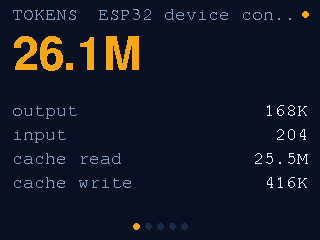
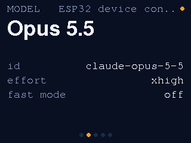
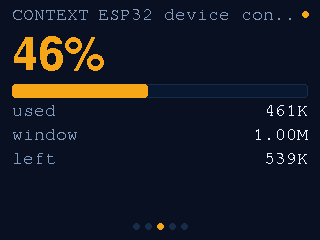
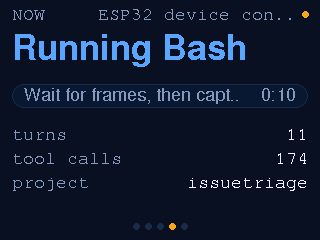
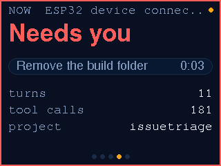
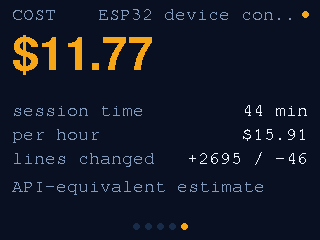

# Claude cube

Your current Claude Code session on an M5Stack CoreS3, over the USB cable. Shake the cube (or tap the screen) to flip pages:

| Page | Shows |
|---|---|
| Tokens | Session total, then output, input, cache read, cache write |
| Model | Model name and id, effort level, fast mode |
| Context | How full the context window is, with a bar that turns red at 80% |
| Now | Thinking, running a tool, needs you, or your turn, with a timer |
| Cost | API-equivalent cost, session time, cost per hour, lines changed |

When Claude needs your permission or input, the cube chimes, draws a red border and jumps to the Now page.

## Requirements

- An M5Stack CoreS3 (not the CoreS3 SE, which has no IMU to shake) connected to a Mac by USB-C
- Claude Code (CLI or desktop app), which writes session transcripts to `~/.claude/projects/`
- macOS `/usr/bin/python3` (3.9+) for the host side; nothing to `pip install`
- [uv](https://docs.astral.sh/uv/) to run PlatformIO and esptool without installing them (`uvx`)

## Layout

```
claude-cube/
├── firmware/                 Arduino + M5Unified, built with PlatformIO
│   ├── flash.sh              build, pause the bridge, flash with esptool v5
│   └── src/
│       ├── main.cpp          loop: read frames, shake/tap to flip, chime when Claude needs you
│       ├── frameLink.*       newline-delimited JSON frames over USB serial, plus snap/next commands
│       ├── pages.*           the five pages, drawn to a PSRAM canvas
│       ├── shakeDetector.*   two jolts within 500 ms = one shake
│       ├── format.*          1.38M, 38 min, $4.12
│       └── theme.h           Midnight Crema colors
├── host/                     Python 3.9+ standard library only
│   ├── hook.py               Claude Code hook: summarizes each event, starts the bridge
│   ├── bridge.py             reads hook events and the transcript, sends frames to the cube
│   ├── snap.py               screenshots the cube's screen to PNG
│   ├── claudecube/           transcript reader, activity state, pricing, frame format, serial link
│   └── tests/                pytest
└── docs/                     screenshots captured with snap.py
```

## How it works

```
Claude Code hooks ──> host/hook.py ──(unix socket)──> host/bridge.py ──(USB serial, 1 JSON line)──> cube
                                                         │
                                         reads the session transcript (~/.claude/projects/...)
```

- `host/hook.py` runs on each hook event as an async hook, so it never slows Claude down. It sends only the
  event name, tool name and a short label (a file name or the Bash description), never prompts, commands or file contents.
- `host/bridge.py` starts on the first event, follows whichever session was active most recently, reads token
  usage from its transcript and its subagents' transcripts, and sends a frame on every change plus a heartbeat every
  2 s. It exits after 3 idle hours.
- Pressing Esc or closing a terminal sends no hook event, so a session that has been thinking or running a tool with
  no events for 10 minutes shows as Idle.
- The cost figure uses API list prices (see `host/claudecube/pricing.py`); on a subscription plan it is an estimate of
  what the same tokens would cost on the API, not a bill.

Host code is Python 3.9+ standard library only. State lives in `~/.claude-cube/` (socket, pid file, `bridge.log`).

## Screens

Captured from the device with `host/snap.py --all docs`:

| Tokens | Model | Context |
|---|---|---|
|  |  |  |

| Now | Needs you | Cost |
|---|---|---|
|  |  |  |

## Commands

```bash
# Build and flash the firmware (pauses the bridge while uploading)
firmware/flash.sh

# Screenshot the cube: the current page, or every page
/usr/bin/python3 host/snap.py out.png
/usr/bin/python3 host/snap.py --all docs/

# What the cube is showing right now, without the cube
cat ~/.claude-cube/last-frame.json

# Is the bridge running or paused, and which port would it use?
/usr/bin/python3 host/bridge.py --status

# Stop the bridge (the next hook event starts it again)
/usr/bin/python3 host/bridge.py --stop

# Host tests
cd host && uvx --python /usr/bin/python3 pytest -q
```

While `~/.claude-cube/paused` exists, the bridge keeps off the serial port and the cube shows "Waiting for Mac".
`flash.sh` and `snap.py` create it while they use the port and delete it afterwards. Another firmware project on the
same board can create it to keep the bridge away for as long as it needs, and must delete it to hand the cube back.
The bridge notes each pause and resume in `~/.claude-cube/bridge.log`, and `bridge.py --status` shows how long it has
been paused.

`flash.sh` builds with PlatformIO but flashes with esptool v5: PlatformIO's bundled esptool 4.5.1 loses the CoreS3's
native USB right after its stub starts ("No serial data received").

Set `CLAUDE_CUBE_DISABLE=1` (for example in the `env` block of `~/.claude/settings.json`) to make the hook do nothing,
or `CLAUDE_CUBE_PORT` to pick the serial port yourself. Otherwise the bridge, `flash.sh` and `snap.py` use the first
USB serial port whose device has Espressif's vendor id (0x303a), found with `ioreg`, so other boards and serial
monitors on other ports are left alone.

## Install and uninstall

1. Back up the cube's original firmware first; flashing replaces it:
   `uvx esptool --port /dev/cu.usbmodem<N> read-flash 0 ALL cores3-backup.bin`
2. Flash the cube: `firmware/flash.sh`
3. Add one async command hook to `~/.claude/settings.json` for each of SessionStart, UserPromptSubmit, PreToolUse,
   PostToolUse, PostToolUseFailure, PermissionRequest, Notification, Stop, StopFailure and SessionEnd, with the
   absolute path to this checkout:

   ```json
   { "hooks": [{ "type": "command", "async": true,
                 "command": "/usr/bin/python3 /path/to/M5Stack-CoreS3/claude-cube/host/hook.py" }] }
   ```

The bridge starts by itself on the next Claude Code event.

To uninstall, delete those ten hook entries, run `host/bridge.py --stop`, and remove `~/.claude-cube/`. To put the
original firmware back: `uvx esptool --port /dev/cu.usbmodem<N> write-flash 0 cores3-backup.bin`.
