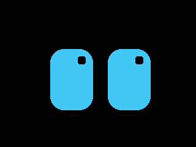
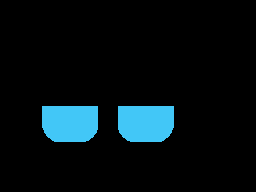
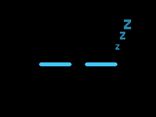
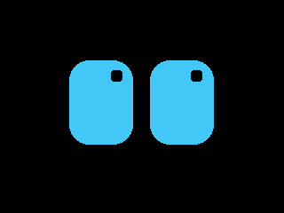
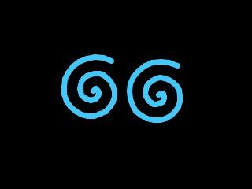
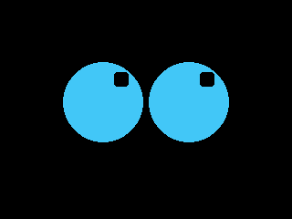
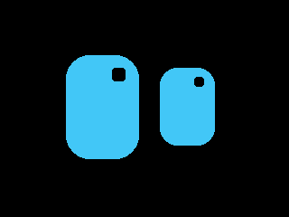

# Desk buddy

A pair of big cyan eyes that lives on the CoreS3 and reacts to how you treat it. Shake it, slap it, stroke it, tilt
it, or ignore it: it blinks, glances around, and has ten moods, each with its own face and a little sound.

| | | | | |
|---|---|---|---|---|
|  idle |  bored |  asleep |  happy |  excited |
|  dizzy |  angry |  surprised |  curious |  loved |

Screenshots taken from the device with `host/buddy.py gallery docs`. On the cube every face moves: blinks, glances,
bounces, spinning spirals, beating hearts, floating Zs.

## What makes it feel what

| Do this | It gets | Face | Sound |
|---|---|---|---|
| Nothing | **idle** | blinks every 2 to 5 s, glances around | quiet |
| Nothing for 2 minutes | **bored** | half-closed eyes drift down and away | a sigh |
| Nothing for 7 minutes | **asleep** | closed eyes, floating Zs, screen dims | quiet |
| Shake gently | **happy** | smiling arcs | a chirp |
| Shake harder | **excited** | eyes bounce and squash; the harder, the bigger | rising beeps |
| Shake hard for over 1.2 s | **dizzy** | spinning spirals for 4 s, even after you stop | a wobble |
| Slap it (one sharp hit) | **angry** | slanted red eyes that tremble | a grumble |
| Slap it again soon | angrier | angry for 4 s longer per slap, up to 4 levels; forgiven over 20 s each | |
| Bump it or tap the screen | **surprised** | wide round eyes | a "huh?" |
| Stroke the screen | **loved** | beating pink hearts | a little tune |
| Tilt it, or bring a hand close | **curious** | one eye bigger, both roll toward the tilt | a question beep |

Anything wakes it from sleep (surprised). A slap beats everything; dizziness runs its course before anything but a slap
can interrupt it. After excitement it calms down through happy before going back to idle.

## How it works

- **Motion, 100 times a second.** A task on core 0 reads the BMI270 every 10 ms, so a slap that lasts 20 ms is not
  missed while core 1 spends ~30 ms pushing each frame. Touch, the proximity sensor and the IMU share one I2C bus, so
  every access takes a lock.
- **`lib/buddy/motion`** splits gravity from movement with a low-pass filter. A short, isolated jolt (under 150 ms,
  with stillness before and after) is a tap, or a slap if it peaks above 1.8 g. Movement that keeps going is a shake,
  graded gentle, medium or hard by its smoothed energy. Tilt is measured against the pose the cube usually sits in, which
  it relearns over about 20 s, so a cube that lives on its side stops looking curious.
- **`lib/buddy/mood`** turns those signals plus idle time into one mood, with the priorities and timings above.
- **`src/eyes`** eases between poses each frame and draws arcs, spirals, hearts or closed lids for the moods that need
  them. `src/voice` plays each mood's notes without blocking the animation. `src/proximity` is a minimal LTR-553
  driver that learns its own baseline.

The motion and mood logic is plain C++ with no Arduino dependencies, tested on the Mac (23 tests).

## Run it

```bash
desk-buddy/firmware/flash.sh                                      # build and flash (pauses the claude-cube bridge)
cd desk-buddy/firmware && uvx platformio test -e native           # logic tests on the Mac
/usr/bin/python3 desk-buddy/host/buddy.py status                  # mood, shake energy, tilt, slaps, taps, proximity
/usr/bin/python3 desk-buddy/host/buddy.py mood dizzy              # show a mood now (handy when filming)
/usr/bin/python3 desk-buddy/host/buddy.py gallery desk-buddy/docs # screenshot every mood
```

Serial commands, one per line: `status`, `mood <name>`, `snap` (screenshot, the same protocol as claude-cube; the PNG
encoder comes from claude-cube's host code).

## Tuning

Hardware tuned only from the code's point of view so far; these are the knobs if it feels too touchy or too dull:

| What | Where | Now |
|---|---|---|
| How hard a hit counts as a slap | `SLAP_G` in `lib/buddy/src/motion.cpp` | 1.8 g |
| Smallest jolt that counts at all | `JOLT_ON_G` | 0.35 g |
| Medium / hard shake | `MEDIUM_ENERGY`, `HARD_ENERGY` | 0.5 / 1.2 g |
| Bored / asleep after | `MoodTimings` in `lib/buddy/src/mood.h` | 2 / 7 min |
| How close a hand must be | `NEAR_ON` in `src/proximity.cpp` | 120 counts over its baseline |
| Volume, brightness | `SPEAKER_VOLUME` in `src/main.cpp`, `theme.h` | 90, 110 (20 asleep) |

## Layout

```
desk-buddy/
├── firmware/
│   ├── flash.sh           build, pause the claude-cube bridge, flash with esptool v5
│   ├── platformio.ini     cores3 (the device) and native (tests on the Mac)
│   ├── lib/buddy/src/     motion classifier and mood engine: no Arduino, fully tested
│   ├── src/               eyes, voice, proximity, the 100 Hz motion task, main loop and serial commands
│   └── test/              Unity tests for lib/buddy
├── host/buddy.py          status, force a mood, screenshot gallery
└── docs/                  screenshots taken from the device
```

## Going back to claude-cube

One firmware at a time: this project's `flash.sh` leaves `~/.claude-cube/paused` in place so the claude-cube bridge
stays off the port. Run `claude-cube/firmware/flash.sh` to put the cube back.
