# Drama Queen

A cube that overreacts to everything. Toss her and she screams, tilt her and she gets seasick, put her face down
and she sobs, slap her and she calls her lawyer. Every reaction has its own face, a line in a speech bubble, and a
gibberish voice that "says" it.

| | | | | | |
|---|---|---|---|---|---|
| 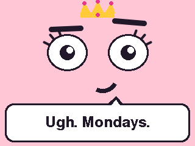 idle | 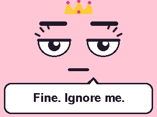 bored | 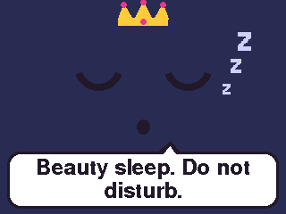 asleep | 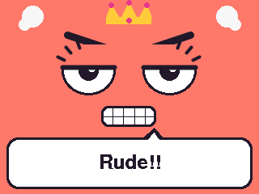 woken | 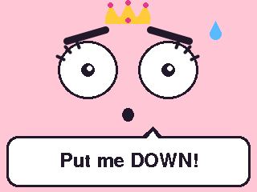 picked up | 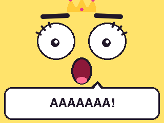 wheee |
| 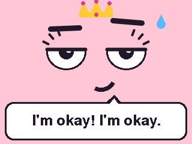 landed | 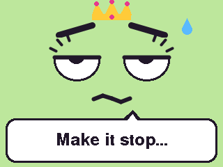 queasy | 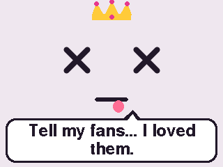 fainted | 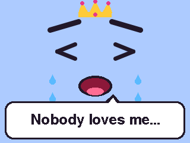 sobbing | 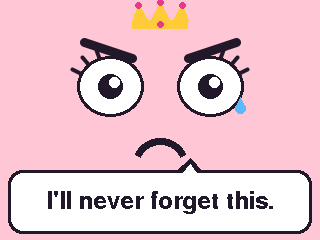 betrayed | 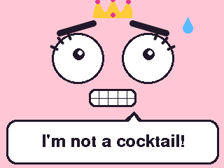 rattled |
| 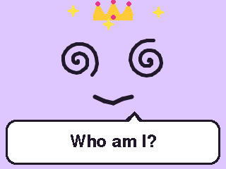 dizzy | 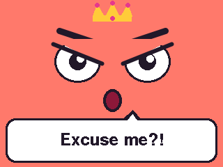 outraged | 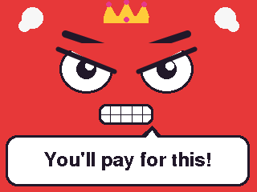 furious | 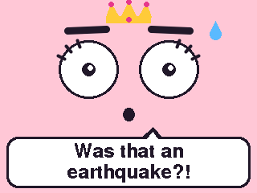 startled | 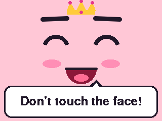 tickled | 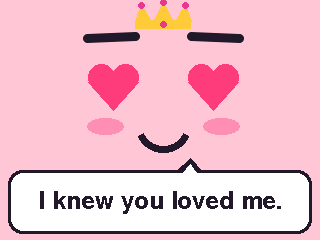 smitten |

Screenshots taken from the device with `host/drama.py gallery docs`. On the cube everything moves: blinks, tears,
trembling rage, spinning eyes, floating Zs, typed-out lines.

## What sets her off

| Do this | She | Says something like |
|---|---|---|
| Nothing | idles, smug, glancing about | "I'm literally the main character." (every 30 s) |
| Nothing for a minute | gets bored | "Entertain me." |
| Nothing for 3 minutes | goes to sleep, screen dims | "Beauty sleep. Do not disturb." |
| Anything while she sleeps | wakes up cross | "I WAS SLEEPING!" |
| Pick her up after she rested | panics | "Careful! I'm fragile!" |
| Toss her (in the air for 100 ms+) | screams, then rates the landing | "WHEEEEEE!" ... "MY SPINE!" |
| Hold her tilted for 1.5 s | turns green | "I'm going to be sick..." |
| Lay her on her back | faints | "Tell my fans... I loved them." |
| Lay her face down | sobs | "Nobody loves me..." |
| Turn her back up after that | feels betrayed | "How could you?!" |
| Shake her | rattled | "STOP SHAKING ME!" |
| Shake her hard for a second | dizzy, spinning eyes and stars | "I see stars..." |
| Slap her | outraged | "HOW DARE YOU!" |
| Slap her again within 15 s | furious, steaming | "I'm calling my lawyer." |
| Bump her | startled | "Eek!" |
| Tap the screen | tickled | "Hehe! Stop it!" |
| Stroke the screen | smitten, heart eyes | "I knew you loved me." |

Being in the air beats everything; a slap beats everything else; dizziness runs its course. Each reaction has three
to five lines and never repeats the last one.

## How it works

- **Motion, 100 times a second** on core 0 (`lib/drama/src/motion`), separated into gravity and movement:
  - *In the air*: total acceleration under 0.35 g for 100 ms. Landing is when it comes back.
  - *Face down / on her back*: gravity along the screen's outward axis below -0.8 / above 0.8.
  - *Slap*: a spike of at least 2 g, judged on its own 300 ms in, whatever else is moving. Nothing in the 300 ms
    before its rise or after its fall may reach 60% of it, and it must not be the thud of a landing. This came from
    real slaps on this board: they peaked at 2.4 to 7.2 g, but she was often already moving in a hand and kept
    rocking for up to 2 s afterwards, so "a short, isolated jolt" missed them. A hard shake always has a swing as
    strong next to it, which is how it is told apart; a very fast flurry of slaps reads as a shake too.
  - *Tap*: a short, isolated jolt under 2 g (real taps: 0.5 to 0.8 g, 50 to 80 ms).
  - *Shake* graded by smoothed energy; *tilt* against the pose she usually sits in, relearned over ~20 s;
    *pick-up* is movement after at least 3 s of rest.
- **`lib/drama/src/drama`** turns those into one of 18 reactions with priorities and timings.
- **`lib/drama/src/synth`** builds each line as one clip: a sound effect (scream sweep, landing thud, gasp, growl,
  giggle, snore) and then gibberish syllables, one per ~3 letters, rising for questions, louder for capitals, with a
  wobble when sobbing or queasy. `src/voice` plays it from PSRAM without blocking the animation.
- **`src/face`** draws the face from a table of expressions (eyes, brows, mouth, extras such as tears, sweat, stars,
  steam, Zs); `src/bubble` types out the line; `src/lines` holds what she says.

The motion, drama and synth code is plain C++ with no Arduino dependencies: 38 Unity tests run on the Mac.

## Run it

```bash
drama-queen/firmware/flash.sh                                   # build and flash (pauses the claude-cube bridge)
cd drama-queen/firmware && uvx platformio test -e native        # 38 tests on the Mac
/usr/bin/python3 drama-queen/host/drama.py status               # reaction, line, gravity, falls, slaps, taps...
/usr/bin/python3 drama-queen/host/drama.py hits                 # last 16 jolts: peak, duration, and why they counted
/usr/bin/python3 drama-queen/host/drama.py react furious        # act out a reaction for 8 s (for filming)
/usr/bin/python3 drama-queen/host/drama.py gallery drama-queen/docs
```

Serial commands, one per line: `status`, `hits`, `react <name>`, `snap` (screenshot; the PNG encoder comes from
claude-cube's host code).

## Tuning

| What | Where | Now |
|---|---|---|
| Slap strength | `SLAP_G` in `lib/drama/src/motion.cpp` | 2.0 g |
| How long in the air counts as a toss | `FREE_FALL_MS` | 100 ms |
| Face down / on her back | `FACE_DOWN_Z`, `ON_BACK_Z` | -0.8 / 0.8 |
| Bored, asleep, how long each reaction lasts | `Timings` in `lib/drama/src/drama.h` | 1 min, 3 min, ... |
| Her lines and how often she chatters | `src/lines.cpp` | |
| Voices and sound effects | `styleFor`, `addEffect` in `src/voice.cpp` | |
| Volume | `SPEAKER_VOLUME` in `src/main.cpp` | 150 |

## Layout

```
drama-queen/
├── firmware/
│   ├── flash.sh           build, pause the claude-cube bridge, flash with esptool v5
│   ├── platformio.ini     cores3 (the device) and native (tests on the Mac)
│   ├── lib/drama/src/     motion, drama (reactions), synth (voice): no Arduino, fully tested
│   ├── src/               face, speech bubble, lines, voice, 100 Hz motion task, main loop and serial commands
│   └── test/              Unity tests for lib/drama
├── host/drama.py          status, hits, act out a reaction, screenshot gallery
└── docs/                  screenshots taken from the device
```

## Going back to claude-cube

One firmware at a time: this project's `flash.sh` leaves `~/.claude-cube/paused` in place so the claude-cube bridge
stays off the port. Run `claude-cube/firmware/flash.sh` to put the cube back.
