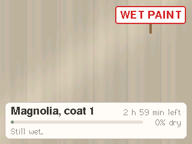
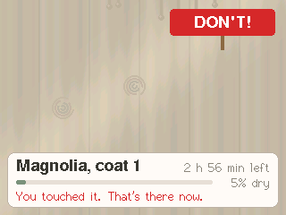
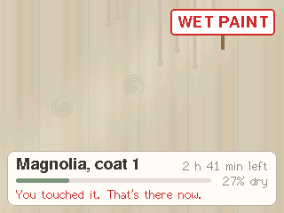
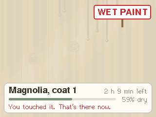
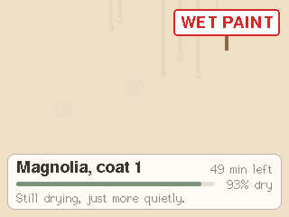
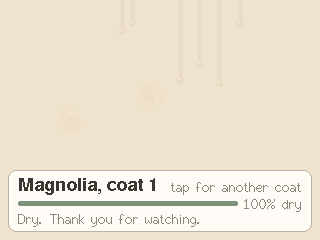
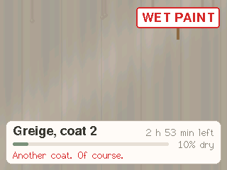

# Watching Paint Dry

A boring app, on purpose. The screen is a freshly painted wall, and it dries, in real time, over three hours.
That's it. The paint starts dark and glossy, the sheen and the roller marks fade, a few drips creep down and set, and a
small card reports progress with appropriate solemnity. Touch it while it is wet and your fingerprint stays there
until the next coat. Once it is dry, tap for another coat in another thrilling shade. No sound.

| | | | |
|---|---|---|---|
|  just painted |  touched |  dripping, 18 min |  tacky, 50 min |
|  touch-dry, 2 h 10 |  dry, 3 h |  another coat | |

Screenshots taken from the device with `host/paintdry.py gallery docs`, which jumps through the hours so you don't
have to.

## What happens

| When | Stage | It says |
|---|---|---|
| 0 to ~30 min | wet: dark, glossy, drips creeping | "Still wet.", "Drying has begun. Probably." |
| ~30 to ~75 min | tacky: drips have set | "Slightly less wet.", "Progress is being made, technically." |
| ~75 min to 3 h | touch-dry | "It looks dry. It is not dry.", "Still drying, just more quietly." |
| 3 h | dry: the sign comes down | "Dry. Thank you for watching." |

- **Touch it while wet or tacky** and it keeps your fingerprint until the next coat; the sign turns red and says
  DON'T!, and the card says "You touched it. That's there now."
- **Touch it once touch-dry**: "Touch-dry. You got away with it."
- **Tap it once dry** for another coat: Magnolia, Greige, Eggshell, Beige, Off-White, Light Grey, and round again.
- The remark changes every five minutes. Drying is fastest at first (a quarter done in the first 18 minutes) and
  slowest at the end (the last 20% takes half the time), as paint does.
- **Unplug it** and nothing is lost: the coat and how long it has been drying are saved every minute. Fingerprints
  are not saved, so a power cut is the one way to clean the wall.

## How it works

- **The coat** (`lib/paint/src/wall`): dryness is `(1 - e^(-3t/T)) / (1 - e^-3)` over T = 3 hours, so it is exactly 1
  when the time is up. Wet below 0.4, tacky below 0.75, touch-dry until the end. Each coat's drips are placed from
  a seed and the coat number, and their length is a function of dryness rather than a running total, so a coat
  restored after a reboot, or jumped to a later point, looks exactly as it would have. Fingerprints keep their spot
  and angle; the wall keeps the latest 32.
- **The words** (`lib/paint/src/words`): stage names, "2 h 38 min left", the remarks, the replies to a touch.
- **Drawing** (`src/view`): each pixel is one of 64 shades of the coat's colour, chosen by its column's roller mark
  (a ripple and a lap line where two passes meet, different each coat) plus a diagonal gloss band; both fade with
  the wetness, and wet paint is 20% darker. Drips, fingerprints (broken concentric rings at an angle), the sign and
  the card go on top. Ten frames a second is plenty for paint.
- **No motion sensor, no microphone, no speaker**: they are switched off. Nothing here moves.

## Run it

```bash
paint-dry/firmware/flash.sh                                  # build and flash (pauses the claude-cube bridge)
cd paint-dry/firmware && uvx platformio test -e native       # 17 tests on the Mac
/usr/bin/python3 paint-dry/host/paintdry.py status           # coat, colour, stage, how dry, how long left
/usr/bin/python3 paint-dry/host/paintdry.py speed 60          # an hour a minute, for the impatient (until reboot)
/usr/bin/python3 paint-dry/host/paintdry.py at 90            # jump to 90 minutes into this coat
/usr/bin/python3 paint-dry/host/paintdry.py touch 160 120    # a finger on the wall
/usr/bin/python3 paint-dry/host/paintdry.py reset            # a fresh first coat, in real time
/usr/bin/python3 paint-dry/host/paintdry.py gallery paint-dry/docs
```

Serial commands, one per line: `status`, `snap`, `at MINUTES`, `speed N`, `touch X Y`, `coat N`, `reset`,
`untouchable MS` (ignore the touchscreen for a while, so screenshots show only what a script did). The PNG encoder
comes from claude-cube's host code.

## Tuning

| What | Where | Now |
|---|---|---|
| How long a coat takes | `DEFAULT_DRYING_S` in `lib/paint/src/wall.h` | 3 hours |
| How front-loaded the drying is | `CURVE` in `lib/paint/src/wall.cpp` | 3 |
| When wet turns tacky, tacky turns touch-dry | `WET_UNTIL`, `TACKY_UNTIL` | 0.4, 0.75 |
| The remarks and how often they change | `lib/paint/src/words.cpp` | every 5 min |
| The colours and their names | `COATS` in `src/theme.h` | six dull shades |
| How much darker wet paint looks | `WET_SHADE` | 0.8 |

## Layout

```
paint-dry/
├── firmware/
│   ├── flash.sh           build, pause the claude-cube bridge, flash with esptool v5
│   ├── platformio.ini     cores3 (the device) and native (tests on the Mac)
│   ├── lib/paint/src/     wall (a coat drying), words (what it says): no Arduino, fully tested
│   ├── src/               the wall's drawing, main loop, saving to NVS, serial commands
│   └── test/              Unity tests for lib/paint
├── host/paintdry.py       status, jump in time, speed up, touch, screenshot, gallery
└── docs/                  screenshots taken from the device
```

## Going back to claude-cube

One firmware at a time: this project's `flash.sh` leaves `~/.claude-cube/paused` in place so the claude-cube bridge
stays off the port. Run `claude-cube/firmware/flash.sh` to put the cube back.
