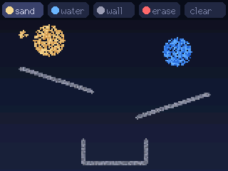
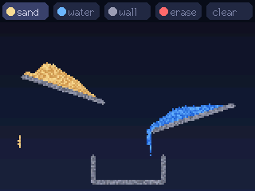
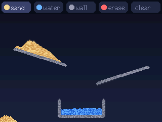
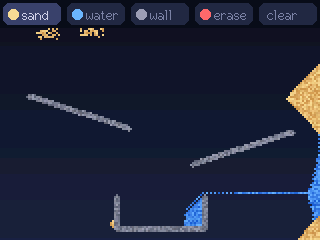
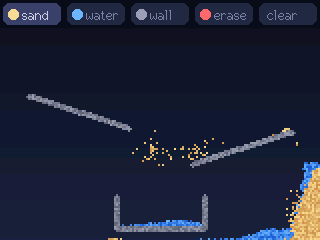
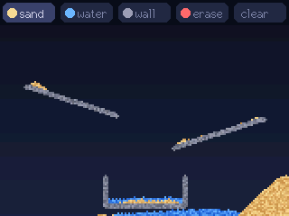

# Sandbox

A falling-sand box in your hand. Draw sand, water and walls with your finger, and gravity follows the way you
hold the board: stand it up and the sand pours to the bottom of the screen, tip it and everything slides to that
side, turn it over and it all falls the other way, lay it flat on the desk and your sculpture stays put. Shake it
to stir everything up. No sound.

| | | |
|---|---|---|
|  the starting scene |  stood up: sand slides down the ramp, water runs into the cup |  settled |
|  tipped onto its right side |  shaken |  stood back up |

Screenshots taken from the device with `host/sandbox.py demo docs`, which pretends to tilt and shake it from the Mac.

## How to play

- **Pick a material** in the toolbar: sand, water, wall, or erase. "clear" empties the box.
- **Draw** with your finger. Sand and water are sprinkled, so they look like grains; hold your finger still and
  they keep pouring from that spot. Walls are solid and hold anything.
- **Tilt it.** Down is wherever the ground is, in eight directions: straight, sideways or diagonal. The more upright
  the board, the faster things fall; nearly flat (within ~12 degrees), nothing moves.
- **Shake it** to stir: grains jump around until you stop.

It starts with two ramps, a cup, and some sand and water waiting at the top, so the first tilt already does something.

## How it works

- **The simulation** (`lib/sand/src/world`): a 160 x 106 grid, each cell 2 x 2 pixels, holding empty, sand, water
  or wall plus a shade fixed per grain, so a heap stays grainy as it moves. Each step every grain tries to move one
  cell down, sweeping from the far side of "down" so a falling column moves as one. Sand slides off diagonally
  when blocked (heaps settle at 45 degrees) and sinks through water by swapping places with it; water also spreads
  sideways. Coin flips use xorshift: a plain LCG's low bits cycle, and in testing they left water unsettled for
  61 of 200 seeds.
- **Gravity** (`lib/sand/src/gravity`): the accelerometer reading, smoothed over ~50 ms, gives the direction of down
  on the screen, rounded to the nearest of the eight neighbours, and its strength. The strength paces the steps:
  75 a second upright, fewer as it lies back, none below 0.2 g.
- **Shaking** (`lib/sand/src/shake`): judged by how far the reading's strength strays from 1 g. Turning the board
  over (to pour the other way) only changes the reading's direction, so it never counts as a shake.
- **Two cores**: the sand runs in its own task on core 0 next to the IMU task, and owns the world. Touch and serial
  edits reach it through a queue, and after each step it copies the grid into a frame (17 KB, ~0.1 ms). Core 1
  draws from that frame straight into the screen buffer and pushes it. Neither waits for the other, so the screen
  holds ~30 frames a second (the push alone takes 31 ms) whether the box holds 1,000 grains or 6,000; a very full
  box makes the sand fall a little slower instead.

What it took to get there, measured on the board (`status` reports these timings):

| Change | Grains | Frame rate | Time per step |
|---|---|---|---|
| First version: everything on core 1, frame in internal RAM | ~1,100 | 17.6 fps | |
| Skip empty cells without a call; draw from the raw cells | ~1,100 | 22.2 fps | |
| Sand on core 0, sharing the grid through a mutex | ~5,800 | 17 fps (core 1 waited for the lock) | 13.4 ms |
| Built with `-O2` instead of `-Os` | ~5,500 | 25.6 fps | 9.5 ms |
| Inner loop in IRAM | ~5,700 | 25 fps | 8.6 ms |
| Sand owns the grid; edits by queue, drawing from a copy | ~6,100 | **30.3 fps** | 9.5 ms, on core 0 where it no longer holds up the screen |

## Run it

```bash
sandbox/firmware/flash.sh                                    # build and flash (pauses the claude-cube bridge)
cd sandbox/firmware && uvx platformio test -e native         # 25 tests on the Mac
/usr/bin/python3 sandbox/host/sandbox.py status              # gravity, shake, grain counts, fps, timings
/usr/bin/python3 sandbox/host/sandbox.py paint sand 80 20 10 # a disc of sand at cell 80, 20
/usr/bin/python3 sandbox/host/sandbox.py gravity 1 0         # pretend it lies on its right side for 5 s
/usr/bin/python3 sandbox/host/sandbox.py shake 1500
/usr/bin/python3 sandbox/host/sandbox.py demo sandbox/docs
```

Serial commands, one per line, in cells (160 x 106, 0 0 at the top left of the box): `status`, `snap`, `clear`,
`scene`, `tool NAME`, `paint MATERIAL X Y R [DENSITY]`, `line MATERIAL X0 Y0 X1 Y1 R`, `gravity DX DY [MS]`,
`shake [MS]`. The PNG encoder comes from claude-cube's host code.

## Tuning

| What | Where | Now |
|---|---|---|
| How fast things fall upright | `STEPS_PER_S_AT_1G` in `lib/sand/src/gravity.cpp` | 75 cells a second |
| How flat counts as flat | `MIN_STRENGTH` | 0.2 g, about 12 degrees |
| How hard a shake must be | `START_G`, `STOP_G` in `lib/sand/src/shake.cpp` | 0.3 g on, 0.15 g off |
| How wildly a shake stirs | `STIR_PERCENT`, `STIR_EVERY_MS` in `src/simTask.cpp` | 20% of grains every 50 ms |
| Brush sizes and how sprinkled | `brushFor` in `src/main.cpp` | sand 3 cells at 35%, water 3 at 45%, wall 2, erase 5 |
| Grain size | `CELL_PX` in `src/view.h` | 2 px |
| Colours | `src/theme.h` | |

## Layout

```
sandbox/
├── firmware/
│   ├── flash.sh           build, pause the claude-cube bridge, flash with esptool v5
│   ├── platformio.ini     cores3 (the device, C++17 at -O2) and native (tests on the Mac)
│   ├── lib/sand/src/      world (the grid and its rules), gravity (down and pacing), shake: no Arduino, tested
│   ├── src/               sim task (core 0), IMU task, drawing and toolbar, main loop and serial commands
│   └── test/              Unity tests for lib/sand
├── host/sandbox.py        status, paint, line, gravity, shake, screenshot, demo
└── docs/                  screenshots taken from the device
```

## Going back to claude-cube

One firmware at a time: this project's `flash.sh` leaves `~/.claude-cube/paused` in place so the claude-cube bridge
stays off the port. Run `claude-cube/firmware/flash.sh` to put the cube back.
