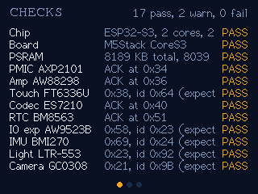
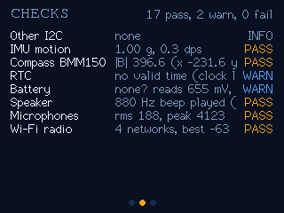
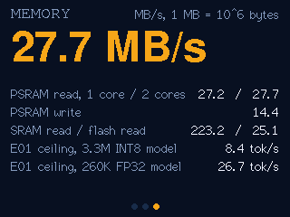

# Smoke test

Checks that every part of the CoreS3 answers, then measures how fast each kind of memory reads. Its memory numbers set
the speed limit for the "LLM on a microcontroller" episode (E01) of the Eight Megabytes season.

It runs once at boot (about 10 s, one beep), shows the results on three screens (tap to flip), and prints a JSON report
over USB that `host/smoke.py` reads back.

| Checks | | Memory |
|---|---|---|
|  |  |  |

## What it checks

| Check | How | Pass when |
|---|---|---|
| Chip, board, PSRAM | `ESP.*`, `M5.getBoard()` | ESP32-S3 with 16 MB flash, board is a CoreS3, at least 8 MB PSRAM |
| Nine I2C parts | Scan the internal bus (G12/G11), then read the ID register where the datasheet gives one | Each part answers; FT6336U `0xA3`=0x64, AW9523B `0x10`=0x23, BMI270 `0x00`=0x24, LTR-553 `0x86`=0x92, GC0308 `0x00`=0x9B |
| IMU | 25 samples at rest | about 1 g and under 5 dps |
| Compass (BMM150, behind the BMI270) | `M5.Imu.getMag()` | a non-zero field |
| RTC, battery | `M5.Rtc`, `M5.Power` (AXP2101) | a valid time; battery between 3.0 and 4.4 V |
| Speaker, microphones | an 880 Hz beep, then half a second of recording | the tone plays; the mics hear something without clipping |
| Wi-Fi | a passive scan | at least one network; only the count and best signal are kept, never network names |
| Memory | read a 4 MB PSRAM buffer (far bigger than the cache) with one core and with both, write it, and read SRAM and 1 MB of mapped flash | numbers only |

## First results (this board, 2026-11-06)

17 pass, 2 warn, 0 fail. All five chip IDs matched their datasheets, including the camera, which answers on I2C before
its clock is running. Full report: [`results/first-run.json`](results/first-run.json).

| Memory | MB/s |
|---|---|
| SRAM read | 223.2 |
| PSRAM read, 1 core | 27.2 |
| PSRAM read, 2 cores together | 27.7 |
| PSRAM write | 14.4 |
| Flash read (memory-mapped) | 25.1 |

What this means for the season:

- **E01 (LLM on the chip).** Decoding reads every weight once per token, so tokens/s can't beat PSRAM bandwidth divided
  by model size: **8.4 tok/s for the 3.3M INT8 model** and 26.7 tok/s for the 260K FP32 one. The plan's figure from
  another S3 board implies about 43 MB/s, so this board's quad PSRAM is roughly a third slower. Adding the second core
  gains only 2%, because both cores share one memory bus. Flash reads about as fast as PSRAM, since it sits on the same
  bus.
- **E03 (gesture wand, "no cable").** The battery check reads 655 mV while USB is at 5.1 V, which looks like no battery
  is connected (the 500 mAh cell is in the bottom module). The RTC has also lost its time, which fits. A cordless wand
  needs the battery bottom attached.
- **E08 (compass over MCP).** The field magnitude read 349 to 397 in M5Unified's units and moved between runs. If those
  are µT, that is several times Earth's 25 to 65 µT. The speaker magnet sits on the same board, so plan a hard-iron
  calibration step before the compass names a direction.

## Run it

```bash
smoke-test/firmware/flash.sh                          # build and flash (pauses the claude-cube bridge)
/usr/bin/python3 smoke-test/host/smoke.py             # print the report from the boot run
/usr/bin/python3 smoke-test/host/smoke.py --rerun     # run everything again (one beep)
/usr/bin/python3 smoke-test/host/smoke.py --save results/run.json --snap docs/
cd smoke-test/host && uvx --python /usr/bin/python3 pytest -q   # host tests
```

`smoke.py` exits with 1 if any check fails. Serial commands, one per line: `report`, `rerun`, `next` (flip screen),
`snap` (screenshot, the same protocol as claude-cube; `--snap` uses claude-cube's PNG encoder).

## Layout

```
smoke-test/
├── firmware/
│   ├── flash.sh          build, pause the claude-cube bridge, flash with esptool v5
│   └── src/
│       ├── main.cpp      boot run, serial commands, tap to flip
│       ├── checks.*      the hardware checks and the expected chip IDs
│       ├── memBench.*    SRAM, PSRAM (1 and 2 cores), and flash bandwidth
│       ├── report.*      JSON report and the E01 ceiling
│       └── screen.*      the three screens
├── host/
│   ├── smoke.py          read or re-run the report, save it, screenshot the screens
│   ├── smokereport.py    find, format and judge a report
│   └── tests/
├── results/              saved reports
└── docs/                 screenshots taken from the device
```

## Going back to claude-cube

Only one firmware fits on the board at a time. This project's `flash.sh` leaves `~/.claude-cube/paused` in place so the
claude-cube bridge stops writing to the port. Run `claude-cube/firmware/flash.sh` to put the cube back; it removes the
pause.
